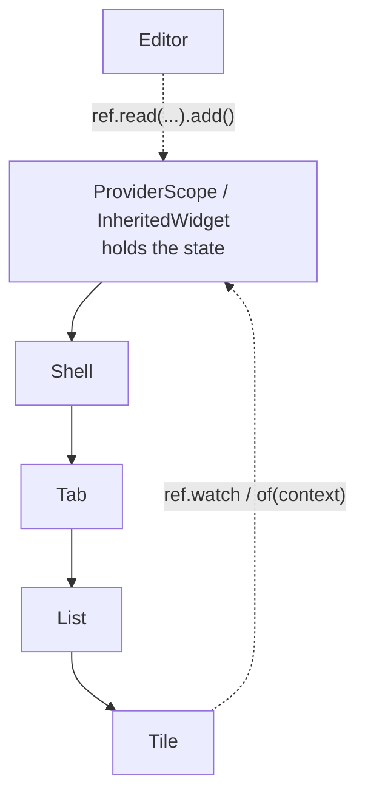
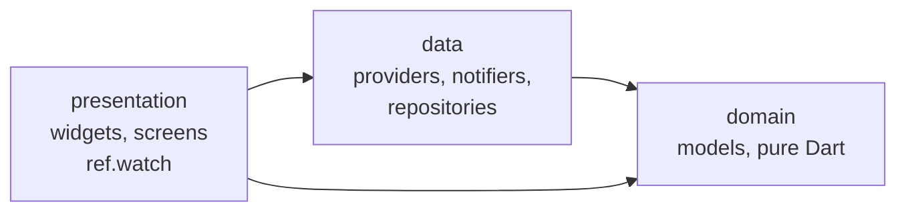

# Week 5 — State management and app architecture

**Outline chapters:** none directly — this is the first of the added
industry topics. It underpins chapters 7 and 8 (persistence, Firebase),
which connect to the architecture built here.
**Slides:** https://betsegawlemma.github.io/mobile-application-development-course/week05/
**Lab:** [lab/README.md](lab/README.md) · **Quiz:** [quiz.md](quiz.md)

## Learning outcomes

By the end of this week you can:

1. **Distinguish** ephemeral (widget) state from app state and **explain**
   why `setState` alone does not scale past a few screens.
2. **Explain** how `InheritedWidget` passes state down the tree, **find**
   an inherited-widget lookup such as `Theme.of(context)` in the app, and
   **compare** how Provider, Riverpod and BLoC build on that idea.
3. **Implement** app state with Riverpod: notifiers, derived providers,
   `ref.watch` vs `ref.read`, and an override in a test that you write
   first; **read** families and async providers with `AsyncValue`.
4. **Organise** a feature into presentation, domain and data layers and
   **give a reason** for where each file goes.
5. **Read** the code that `riverpod_generator` and `freezed` produce, and
   **explain** what the generated provider and the `_$` base class give
   your code.

## Before the lecture

- Read *State management: introduction* and *Ephemeral vs app state*:
  https://docs.flutter.dev/data-and-backend/state-mgmt/intro
- Skim Riverpod *Getting started* and *Providers*: https://riverpod.dev
- Milestone 1 (after week 6) will be reviewed against this week's
  architecture. Read `project/milestones.md`.

---

## 1. The problem

### Why this matters
`setState` is the right tool for a counter. It is not sufficient once two
screens need the same data. The lab app has reached that situation: the
profile name lived in one widget's `State`, so nothing else could read
it, and it was lost when the widget was disposed. Notes have the same
problem on a larger scale: the list, the editor and (from week 8) the
database all need the same list.

### Ephemeral vs app state
- **Ephemeral (UI) state**: a text field's contents, the selected tab,
  an animation's progress, whether a switch is on. One widget cares.
  Keep it in `setState` — that is what it is for.
- **App state**: the signed-in user, the notes list, the cart, cached
  server data. Many widgets, across screens and over time, care. It must
  live *above* the widgets that use it.

The `LifecycleLogger` toggle in `CheckInScreen` is ephemeral state and
stays as it is. The profile name and the notes list are app state and
move into providers this week.

### Passing state down the tree through constructors
You could hold the notes list in the root widget and pass it down as
constructor arguments through the shell, the tab, the list and the tile.
Every intermediate widget then depends on something it does not use;
adding a field means changing ten files. This problem (often called
"prop drilling") is why every framework has a state-management solution.

### InheritedWidget
Flutter's built-in answer: an `InheritedWidget` placed high in the tree
that any descendant can look up via `context`. `Theme.of(context)` and
`MediaQuery.of(context)` are exactly this — you have been using inherited
widgets since week 3. Descendants that call `of(context)` are rebuilt
when the inherited widget's data changes.

Raw `InheritedWidget` is verbose (a widget subclass, an `updateShouldNotify`,
a static `of`) and does not tell you *where* to mutate the state. The
packages below package the pattern.



---

## 2. The options

| | Provider | **Riverpod** | BLoC / Cubit | `setState` + `InheritedWidget` |
|---|---|---|---|---|
| Core idea | `InheritedWidget` wrapper + `ChangeNotifier` | providers declared as globals, resolved by `ref`, no `BuildContext` | streams of events → states, strict separation | Flutter built-ins |
| Amount of repetitive code | low | low (with code generation) | high | medium |
| Compile-time safety | runtime "ProviderNotFound" | compile-time; no context needed | good | runtime |
| Async built in | no (`FutureProvider` limited) | `AsyncValue` with loading/error/data | yes, via states | no |
| Testability | good | excellent (overrides, `ProviderContainer`) | excellent | poor |
| Where you find it | older code bases, tutorials | most new apps; recommended in the Flutter documentation | large enterprise teams, job advertisements | small apps |

All three are reasonable choices, and teams have strong opinions about
them. This course uses **Riverpod** because it needs the least code for
the most safety, it treats asynchronous data as a built-in concept, and it
is the easiest of the three to test. If you later join a team that uses
BLoC, the concepts — immutable state, one-directional data flow,
separation from widgets — apply directly.
`guides/state-management-comparison.md` has a longer comparison.

---

## 3. Riverpod

### Worked examples
The code in this section comes from two small apps in
`lab/starter/lib/exercises/` (the same files are in `lab/solution/`), each
with its tests in `test/exercises/`:

- `lecture_check_in.dart` — a check-in counter on a provider (the live
  coding), and `lecture_check_in_by_hand.dart`, the same provider written
  without the generator;
- `lecture_reminders.dart` — a reminders list: a model, a notifier, a
  derived provider, a family and a page.

The lab asks you to do similar things for notes, the profile and
bookmarks. The code is not the same, so read the examples, then close
them and write your own.

### Setup
`main.dart` wraps the app in one `ProviderScope`, the thing that actually
stores every provider's state:

```dart
// weeks/week05-state-architecture/lab/solution/lib/main.dart
void main() {
  runApp(const ProviderScope(child: CampusCompanionApp()));
}
```

### A provider without the generator
A provider is a global value that tells Riverpod how to create a piece
of state. Here is one written by hand. You only read this form; in the
course you let the generator write it.

```dart
// weeks/week05-state-architecture/lab/starter/lib/exercises/lecture_check_in_by_hand.dart
class CheckInCounter extends Notifier<int> {
  @override
  int build() => 0;

  void checkIn() => state = state + 1;

  void reset() => state = 0;
}

final checkInCounterProvider =
    NotifierProvider.autoDispose<CheckInCounter, int>(CheckInCounter.new);
```

- `CheckInCounter` is a **notifier**: `build()` returns the first state,
  and its methods assign a new `state`.
- `checkInCounterProvider` is the **provider**: the name that widgets
  and tests use to find the counter. `CheckInCounter.new` tells Riverpod
  how to create the notifier.
- `autoDispose` means the state is thrown away when no widget watches it
  any more.

### The same provider with the generator
**The generator writes the provider line for you.** You annotate the
class with `@riverpod`, extend a class whose name starts with `_$`, and
add a `part` line:

```dart
// weeks/week05-state-architecture/lab/starter/lib/exercises/lecture_check_in.dart
part 'lecture_check_in.g.dart';

@riverpod
class CheckInCounter extends _$CheckInCounter {
  @override
  int build() => 0;

  void checkIn() => state = state + 1;

  void reset() => state = 0;
}
```

Then you run the generator:

```bash
dart run build_runner build -d     # once
dart run build_runner watch -d     # or: again after every save
```

It writes `lecture_check_in.g.dart` next to the file. That file contains
`checkInCounterProvider` (auto-dispose by default, as above) and the base
class `_$CheckInCounter`, which gives your class `state` and `ref`. The
`part` line makes the two files one library, so each can use the other's
names, even the private ones that start with `_`. Never edit a `.g.dart`
file: the generator writes it again on the next run. Generated files are
committed in this repository, so CI and classmates do not need to run the
generator to compile.

The generated name drops a `Notifier` suffix: `class CheckInCounter` →
`checkInCounterProvider`; `class ProfileNotifier` → `profileProvider`.

### A provider that computes a value
A provider can also be a function:

```dart
// weeks/week05-state-architecture/lab/solution/lib/features/events/data/events_repository.dart
@riverpod
EventsRepository eventsRepository(Ref ref) => InMemoryEventsRepository();
```

This generates `eventsRepositoryProvider`. It is *lazy* (created on first
use), *cached* (one instance while anything is watching), and
*overridable* (tests swap in a fake).

### Reading providers from widgets
`ConsumerWidget` is a `StatelessWidget` whose `build` gets a `WidgetRef`:

```dart
// weeks/week05-state-architecture/lab/starter/lib/exercises/lecture_check_in.dart
class CheckInPage extends ConsumerWidget {
  const CheckInPage({super.key});

  @override
  Widget build(BuildContext context, WidgetRef ref) {
    final count = ref.watch(checkInCounterProvider);
    return Scaffold(
      // ...
      body: Center(child: Text('Check-ins today: $count')),
      floatingActionButton: FloatingActionButton(
        tooltip: 'Check in',
        // ref.read in a callback: one action, no subscription.
        onPressed: () => ref.read(checkInCounterProvider.notifier).checkIn(),
        child: const Icon(Icons.add),
      ),
    );
  }
}
```

`CheckInBadge` in the same file watches the same provider, so the count
in the app bar and the count on the page always agree. With `setState`
inside `CheckInPage`, the badge could not see the count.

- **`ref.watch(p)`** — subscribe: rebuild this widget whenever `p`
  changes. Use it in `build`.
- **`ref.read(p)`** — read once, no subscription. Use it in callbacks
  (`onPressed`) and `initState`. Never in `build` (the widget would not
  update).
- **`ref.listen(p, (prev, next) {...})`** — side effects such as showing
  a snackbar when something changes.
- **`ref.invalidate(p)`** — throw away the cached value; the next watch
  recomputes.
- **`p.notifier`** — the notifier object itself, for calling its methods.

`ConsumerStatefulWidget` + `ConsumerState` when you also need local state
(text controllers, as in `RemindersPage`).

### Notifier: state plus the methods that change it
```dart
// weeks/week05-state-architecture/lab/starter/lib/exercises/lecture_reminders.dart
@riverpod
class Reminders extends _$Reminders {
  int _nextId = 1;

  @override
  List<Reminder> build() => const [];

  Reminder add(String text, {required DateTime due}) {
    final reminder = Reminder(id: 'r${_nextId++}', text: text, due: due);
    state = List.unmodifiable([...state, reminder]);
    return reminder;
  }

  void markDone(String id) {
    state = List.unmodifiable([
      for (final r in state)
        if (r.id == id) r.copyWith(done: true) else r,
    ]);
  }

  // remove(id) is in the file.
}
```

`build()` returns the initial state. Methods **assign** a new `state`;
Riverpod compares the old and new values with `==` and notifies watchers.
Mutating the list in place (`state.add(reminder)`) would change nothing
on screen — the list is unmodifiable here, so the mistake throws an error
instead of failing without any message. This is why models are
immutable: a new `Reminder` via `copyWith`, a new list via a collection
literal.

### Derived state
```dart
// weeks/week05-state-architecture/lab/starter/lib/exercises/lecture_reminders.dart
@riverpod
List<Reminder> openReminders(Ref ref) {
  final open = ref.watch(remindersProvider).where((r) => !r.done).toList();
  open.sort((a, b) => a.due.compareTo(b.due));
  return open;
}
```

A provider can watch other providers. `openReminders` is recomputed only
when `reminders` changes, and only widgets watching `openReminders`
rebuild. `toList()` makes a new list, so `sort` never changes the list in
`remindersProvider`. Keep widgets simple: put filtering, sorting and
formatting in providers, where they can be tested without a
`WidgetTester`.

### Families: providers with parameters
```dart
// weeks/week05-state-architecture/lab/starter/lib/exercises/lecture_reminders.dart
@riverpod
Reminder? reminderById(Ref ref, String id) {
  return ref.watch(remindersProvider).where((r) => r.id == id).firstOrNull;
}
// usage: ref.watch(reminderByIdProvider('r3'))
```

Each distinct argument gets its own cached instance.

### Async providers and AsyncValue
```dart
// weeks/week05-state-architecture/lab/solution/lib/features/events/data/events_providers.dart
@riverpod
Future<List<Event>> events(Ref ref) {
  return ref.watch(eventsRepositoryProvider).fetchAll();
}
```

Watching a `Future` provider gives an `AsyncValue<T>` — a sealed type
with `AsyncLoading`, `AsyncData(value)` and `AsyncError(error, stack)`.
`when` forces you to handle all three:

```dart
// weeks/week05-state-architecture/lab/solution/lib/features/events/presentation/events_screen.dart
return eventsAsync.when(
  loading: () => const Center(child: CircularProgressIndicator()),
  error: (error, stack) => Center(
    child: Column(mainAxisSize: MainAxisSize.min, children: [
      Text('Could not load events: $error'),
      FilledButton(onPressed: () => ref.invalidate(eventsProvider), child: const Text('Retry')),
    ]),
  ),
  data: (events) { /* build the tabs */ },
);
```

No more `isLoading` booleans and `error` fields you forget to reset.
Week 8 contrasts this with `FutureBuilder`; week 9 connects a REST client
to the same provider without touching the screen.

### Overrides: replacing providers in tests
```dart
// weeks/week05-state-architecture/lab/solution/test/helpers.dart
ProviderScope(
  overrides: [
    routerProvider.overrideWithValue(createRouter(initialLocation: initialLocation)),
    eventsRepositoryProvider.overrideWithValue(FakeEventsRepository()),
    nowProvider.overrideWithValue(testClock),
  ],
  child: const CampusCompanionApp(),
)
```

Because screens depend on providers rather than concrete classes, tests
swap the repository for a fake with no delay, pin the clock, and start at
any route. An override can also give a notifier's provider a fixed state,
so that a widget test starts with known data:

```dart
// weeks/week05-state-architecture/lab/starter/test/exercises/lecture_reminders_test.dart
await tester.pumpWidget(
  ProviderScope(
    overrides: [
      remindersProvider.overrideWithValue([
        Reminder(id: 'x', text: 'Second', due: DateTime(2026, 3, 2)),
        Reminder(id: 'y', text: 'First', due: DateTime(2026, 3, 1)),
      ]),
    ],
    child: const RemindersApp(),
  ),
);
```

Notifiers are unit-tested with a `ProviderContainer` and no widgets at
all:

```dart
// weeks/week05-state-architecture/lab/starter/test/exercises/lecture_reminders_test.dart
container = ProviderContainer.test();
reminders = container.read(remindersProvider.notifier);
// ...
final r = reminders.add('Return books', due: DateTime(2026, 3, 2));

expect(r.id, 'r1');
expect(container.read(remindersProvider), [r]);
```

### Try it
In `lecture_reminders.dart`, change `ref.watch(openRemindersProvider)` to
`ref.read(...)`. Write down what you expect, then run the app with
`flutter run -d chrome -t lib/exercises/lecture_reminders.dart` and add a
reminder. What happens, and why?

---

## 4. Feature-first architecture

### Why this matters
`lib/screens`, `lib/widgets`, `lib/models` works for five files. At
fifty files, every feature is spread across four folders and it is hard
to see what belongs together. Industry code bases group by **feature** and, within
a feature, by **layer**.

```
lib/
├── main.dart                     ProviderScope + runApp
├── app.dart                      MaterialApp.router, theme
├── core/                         shared by all features
│   ├── router/  router.dart, app_shell.dart
│   ├── theme/   app_theme.dart
│   └── presentation/  about_screen.dart
└── features/
    ├── events/
    │   ├── domain/        event.dart            (freezed model, pure Dart)
    │   ├── data/          events_repository.dart, events_providers.dart, sample_events.dart
    │   └── presentation/  events_screen.dart, event_detail_screen.dart, event_card.dart
    ├── notes/
    │   ├── domain/        note.dart
    │   ├── data/          notes_notifier.dart
    │   └── presentation/  notes_screen.dart, note_editor_screen.dart
    ├── profile/   domain/ data/ presentation/
    ├── lost_found/ presentation/
    └── check_in/  presentation/ widgets/
```

### The three layers and the dependency rule



- **domain** — models and business rules. Pure Dart, no Flutter imports,
  no I/O. `Event.isUpcoming` lives here.
- **data** — where data comes from and how it changes: repositories
  (interfaces + implementations), notifiers, providers. Knows about
  domain; knows nothing about widgets.
- **presentation** — widgets. Watches providers, calls notifier methods.
  Contains no business logic.

Dependencies point inward: presentation → data → domain. Never the
reverse. A domain file that imports `package:flutter/material.dart` is a
warning sign; a presentation file that constructs a repository directly
is another.

### Repositories
```dart
// weeks/week05-state-architecture/lab/solution/lib/features/events/data/events_repository.dart
abstract interface class EventsRepository {
  Future<List<Event>> fetchAll();
  Future<Event?> fetchById(String id);
}
```

The interface is what the rest of the app depends on. `InMemoryEventsRepository`
is the current implementation; week 9 adds `RestEventsRepository`, week 10
`FirestoreLostFoundRepository`. The UI does not change. This is the
most valuable habit in this course: **the screen never knows where its
data comes from.**

### freezed
Week 2's manually written `Event` (constructor, `copyWith`, `==`,
`hashCode`, `toString`) is 60 lines that must be kept consistent
manually. `freezed` generates them:

```dart
// weeks/week05-state-architecture/lab/solution/lib/features/events/domain/event.dart
@freezed
abstract class Event with _$Event {
  const factory Event({
    required String id,
    required String title,
    required DateTime start,
    required Venue venue,
    @Default('') String description,
    @Default(true) bool isFree,
  }) = _Event;

  const Event._();   // enables custom methods below

  bool isUpcoming({DateTime? now}) => start.isAfter(now ?? DateTime.now());
}
```

Add `part 'event.freezed.dart';` and run the generator. The `Note`
model in the lab starter is written the same way; in lab Task 0 you find
the generated methods in `note.freezed.dart`. Week 8 adds
`fromJson`/`toJson` with one more annotation. Sealed unions (`@freezed
sealed class Result`) come in week 9 for success/failure results.

> **Optional / Advanced.** `riverpod_lint` + `custom_lint` detect misuse
> (`ref.read` in `build`, missing `ProviderScope`). `AsyncNotifier` for
> notifiers whose initial state is asynchronous (week 8). Layered "clean
> architecture" with use-case classes — more structure than this course
> needs, but you will see it in some code bases.

### Try it
Find the places in `lib/features/events/domain/` that would have to
change if the app switched from Riverpod to BLoC. (Answer: none. That is
the purpose of the domain layer.)

---

## Common mistakes

1. **`ref.read` in `build`** — the widget never updates. `watch` in
   build, `read` in callbacks.
2. **Mutating state in place** — `state.add(x)`, `state.sort()`. Assign
   a new object. The unmodifiable list makes this throw in the lab.
3. **Forgetting to run `build_runner`** after editing a `@riverpod` or
   `@freezed` file — "Classes can only extend other classes" on a new or
   renamed `_$` class, a missing `.g.dart` file, or an old provider. Keep
   `dart run build_runner watch -d` running while you work.
4. **Editing a generated file** — the next generator run overwrites it.
   Change the annotated file instead.
5. **Putting ephemeral state in providers** — text controllers, scroll
   positions, "is this tile expanded". Keep it in the widget.
6. **Business logic in widgets** — sorting the notes inside `build`.
   Move it to a provider so it is testable and reused.
7. **Watching a whole object when you need one field** — `ref.watch(profileProvider)`
   rebuilds on any change; `ref.watch(profileProvider.select((p) => p.name))`
   rebuilds only when the name changes. Optimise when it matters.
8. **Constructing repositories in widgets** — untestable. Provide them
   through a provider and override in tests.
9. **Domain importing Flutter** — a sign that UI details have entered
   the model.

## Industry note

When Flutter team leads review a coding assignment from a job applicant,
they look less at the widgets and more at whether application state is
separated from the UI, whether the data layer is behind an interface, and
whether there are tests that prove it. The structure in this lecture is
close to what you will find in production code bases at companies using
Riverpod (and the same idea, with different names, at companies using
BLoC). Milestone 1 of your project is assessed against it.

## Further reading

- Riverpod docs: https://riverpod.dev/docs/introduction/getting_started ·
  code generation: https://riverpod.dev/docs/concepts/about_code_generation
- `AsyncValue`: https://riverpod.dev/docs/how_to/pull_to_refresh
- Testing providers: https://riverpod.dev/docs/how_to/testing
- freezed: https://pub.dev/packages/freezed
- Flutter's architecture recommendations:
  https://docs.flutter.dev/app-architecture
- BLoC, for comparison: https://bloclibrary.dev

## Key terms

All key terms of the course, in one list: [`guides/glossary.md`](../../guides/glossary.md).

- **ephemeral state** — state that only one widget needs, such as the
  text in a field; it stays in the widget, with `setState`.
- **app state** — state that many widgets, on several screens, need; it
  lives above them, in a provider.
- **inherited widget** — a widget high in the tree that widgets below it
  can find through `context`, as `Theme.of(context)` does.
- **provider** — a global value that tells Riverpod how to create a piece
  of state and lets widgets and tests find it.
- **notifier** — a class that holds a provider's state and has the
  methods that replace it.
- **`ProviderScope`** — the widget at the root of the app that stores the
  state of every provider.
- **watch / read** — `ref.watch` subscribes, so the widget rebuilds when
  the value changes; `ref.read` gets the value once.
- **derived provider** — a provider that computes its value from other
  providers, such as a sorted copy of a list.
- **family** — a provider that takes a parameter and keeps one value for
  each different argument.
- **`AsyncValue`** — the value of an asynchronous provider: loading,
  data or error.
- **override** — a replacement for a provider in one `ProviderScope` or
  `ProviderContainer`, used in tests.
- **code generation** — a tool (`build_runner`) that writes Dart code,
  such as `*.g.dart` and `*.freezed.dart` files, from your annotations.
- **`part` file** — a file joined to another file so that both form one
  library and can use each other's private names.
- **feature-first** — folders grouped by feature (events, notes), each
  split into presentation, domain and data layers.
- **dependency rule** — presentation depends on data, data depends on
  domain, never the other way round.
- **repository** — a class behind an interface that hides where the data
  comes from.
- **immutable** — an object that cannot change after it is created; you
  make a changed copy instead.
